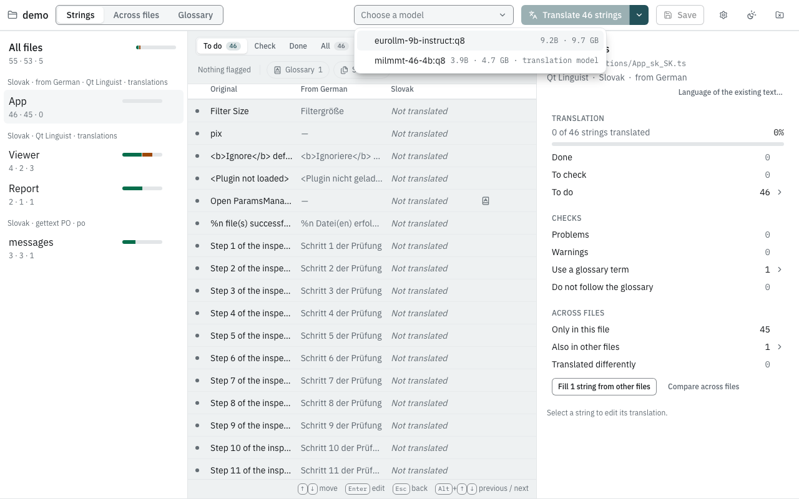
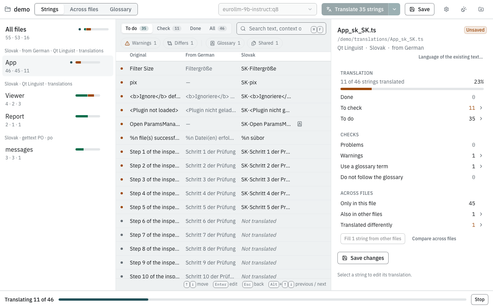
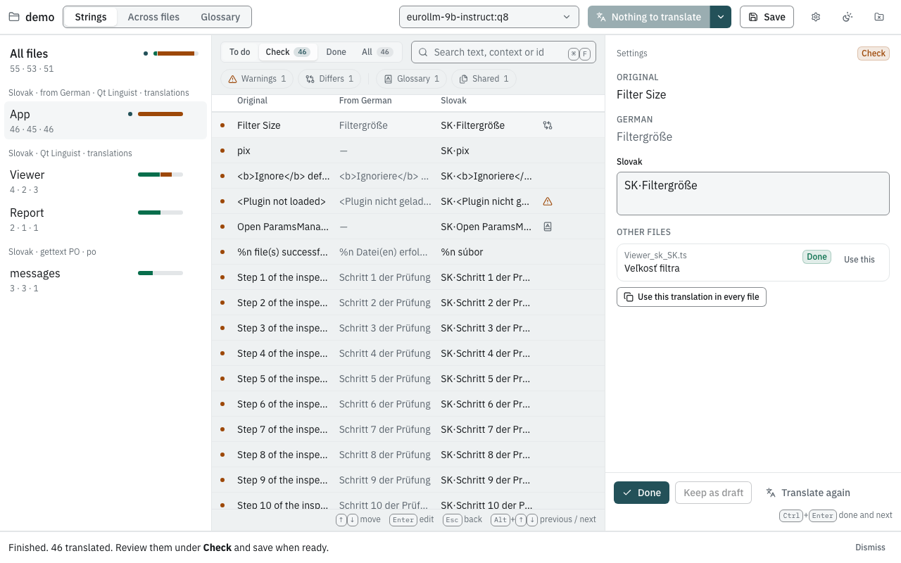
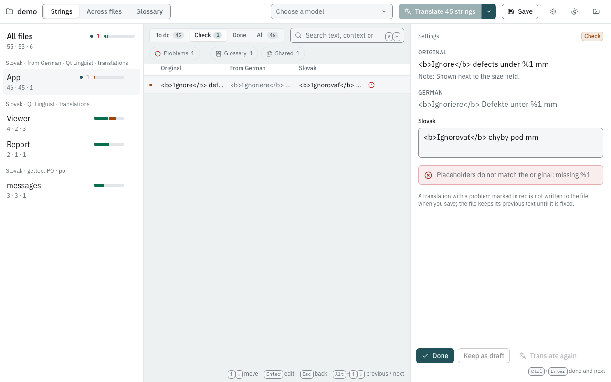
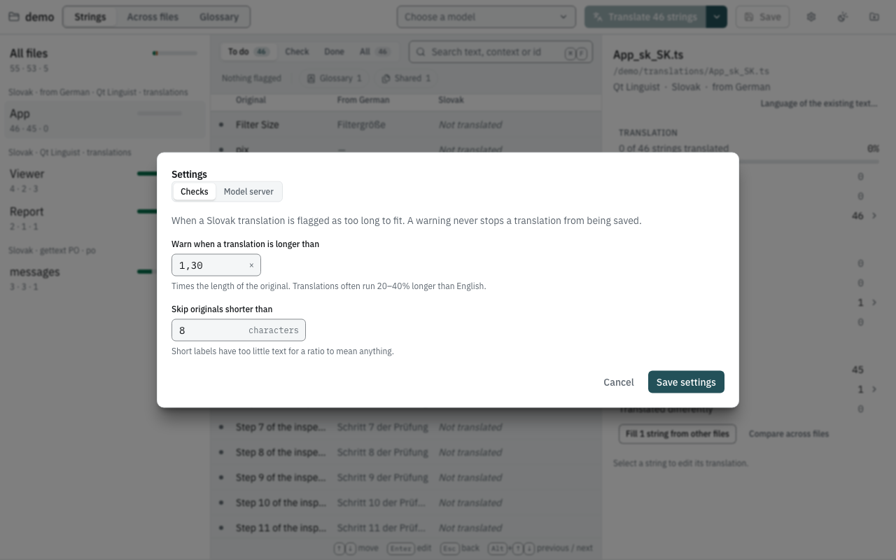
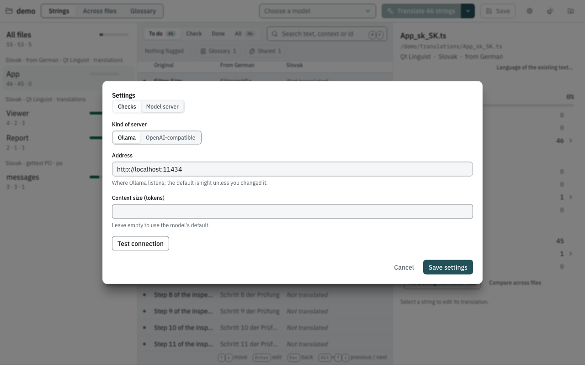

# Your first translation

This walk-through opens a folder of translation files, translates the
missing strings with a model, reviews the result and saves it. It takes
about ten minutes; most of that is the model working.

You need:

- the app ([Install the app](install.md)),
- Ollama with at least one model ([Install Ollama and get a model](models.md)),
- a folder with at least one translation file — a Qt Linguist `.ts`,
  gettext `.po` or ICU message `.json` file. If you have none at hand,
  the [Qt tutorial](../tutorials/qt.md) has a small file to copy.

The screenshots in this book come from the app's demo mode: a Slovak
file pre-filled with German, and a stand-in "model" that just puts `SK·`
in front of the text. A real model writes real Slovak.

> **Work on a copy, or under version control.** The app only changes the
> translations inside your files, but it does save them in place.

## 1. Open the folder

1. Start the app.
2. Click **Open folder…** and choose the folder that holds the
   translation files. It may contain sub-folders; the app searches them
   (up to 8 levels deep, skipping hidden folders and the folders
   `node_modules`, `target`, `dist`, `build` and `__pycache__`).

The workspace opens. On the left are the translation files found, grouped
by what they have in common: a heading such as *Slovak · from German · Qt
Linguist* names the target language, the language of any text already in
the files, and the format (and the folder, when the files live in
several). Each file is listed by its short name, `AcfSln` for
`AcfSln_sk_SK.ts`, with a bar showing how far it is: green for done,
amber for strings to check, grey for the rest still to do. The three
numbers under the name are the file's strings, its **unique** strings
(they occur in no other file) and its translated strings; hover them for
the legend. A red number counts problems and a dot marks unsaved
changes. **All files** at the top shows every file's strings together;
its middle number counts the **distinct** strings, each counted once
however many files have it.

The first time you open a folder, the app creates a settings file
`i18n-harness.toml` in it, and a folder `.i18n-harness/` for its own
bookkeeping. See [The settings file](../reference/settings-file.md) for
what they contain. Add `.i18n-harness/` to your `.gitignore`; keep
`i18n-harness.toml` if you want the settings shared.

## 2. Look around

The middle of the window lists the strings of the selected file:

- The tabs **To do**, **Check**, **Done** and **All** filter by status.
  The numbers are counts; a tab with nothing in it shows none.
  - **To do** — not translated yet.
  - **Check** — has a translation nobody has confirmed: a model
    suggestion or a draft you kept.
  - **Done** — confirmed.
- **Search** finds text in the original, the translation, the context or
  the string's id. <kbd>Esc</kbd> in the field clears it.
- The chips under them narrow the list, each with its count. A chip
  appears only when there is something to show; click it again to turn it
  off, or click **Clear filters**. Each chip has the icon that marks such
  strings in the list:
  - **Problems**: translations that would break the application
    (see step 5);
  - **Warnings**: translations worth a second look, for example ones much
    longer than the original;
  - **Glossary breaks**: translations that do not follow a glossary term;
  - **Differs**: the same string has another translation in another file
    of the folder;
  - **Glossary**: strings whose original contains a glossary term; with
    this or **Glossary breaks** on, a list narrows them to one term (see
    [Use a glossary](../tutorials/glossary.md));
  - **Shared**: strings that occur in more than one file.

The columns are **Original** (the source text; hover it to see its
context) and the target language. For files that arrived filled with
another language there is also a **From …** column; see
[Files pre-filled with another language](../tutorials/pivot.md). Icons at
the end of a row mark a problem, a warning, a glossary term (amber when
the translation does not follow it), or a string translated differently
elsewhere.

While no string is selected, the right panel summarises the file:
where it is on disk, its format and languages, how far it is
(**Done**, **To check**, **To do**), what the checks found
(**Problems**, **Warnings**, glossary use) and how its strings relate to
the other files. Click any count to list those strings.

Click a string to open it in the editor on the right. Press <kbd>Esc</kbd>
in the list, or click the file again, to get the summary back.

### Keyboard

| Keys | Does |
|---|---|
| <kbd>Enter</kbd> on a string | Opens it with the cursor in the translation |
| <kbd>Esc</kbd> in the editor | Back to the list, on the same string |
| <kbd>Esc</kbd> in the list | Back to the file summary |
| <kbd>Alt</kbd>+<kbd>↑</kbd> / <kbd>Alt</kbd>+<kbd>↓</kbd> in the editor | The previous / next string |
| <kbd>Ctrl</kbd>+<kbd>Enter</kbd> (<kbd>⌘</kbd>+<kbd>Enter</kbd>) | Done, and on to the next string |
| <kbd>Ctrl</kbd>+<kbd>F</kbd> (<kbd>⌘</kbd>+<kbd>F</kbd>) | The search field |
| <kbd>Ctrl</kbd>+<kbd>S</kbd> (<kbd>⌘</kbd>+<kbd>S</kbd>) | Save |

The line under the list repeats the most useful ones.

## 3. Choose a model

Open the model list in the toolbar and pick a model:

The note next to each model shows its size and, for dedicated
translation models, *translation model*. The choice is remembered for
this folder.

## 4. Translate

Click **Translate N strings**. This translates every *To do* string of
the selected file. To translate all files of the folder at once, open the
arrow next to the button and choose **Translate all files**.

A progress bar appears at the bottom of the window, and translations
fill in as they arrive:

The **first string can take a minute or more**: the model is being loaded
into memory. After that it is usually well under a second to a few
seconds per string, depending on the model and your computer.

Click **Stop** to end the run early; what is translated so far is kept.
When the run ends, the bar says how many strings were translated and
reminds you to review them under **Check**.

## 5. Review

1. Click the **Check** tab.
2. Click a string. The editor shows the original, any notes the
   developers left, and the suggested translation:

   

3. Correct the text if needed, then:
   - **Done** (or <kbd>Ctrl</kbd>+<kbd>Enter</kbd>, <kbd>⌘</kbd>+<kbd>Enter</kbd>
     on macOS) confirms it and moves to the next string;
   - **Keep as draft** stores your text but leaves the string under
     **Check**;
   - **Translate again** asks the model for a new suggestion for this
     string;
   - **Undo** throws away your unsaved edits in the editor.

For a plural string (for example *"%n file(s) selected"*) the editor
shows one box per plural form of the target language, labelled with the
form and an example number.

### Problems

If a translation would break the application, the editor shows the
problem in red, the string gets a red mark in the list, and **Problems** in the list
next to the search counts it:

Here the placeholder `%1` (the number the application fills in) was lost.
Fix the text so it contains `%1` again and the problem disappears.
[Checks](../reference/checks.md) lists every check and its message.

## 6. Save

Click **Save** in the toolbar (or press <kbd>Ctrl</kbd>+<kbd>S</kbd>,
<kbd>⌘</kbd>+<kbd>S</kbd> on macOS). All files with changes are written;
a dot next to a file name marks unsaved changes.

A translation with a red problem is **not written**: the file keeps its
previous text for that string, and the app tells you
*"Saved, with problems held back"*. The translation stays in the app so
you can fix it and save again.

> **Save before you close.** Translations and edits live in the app until
> you save; **Close** (and quitting the app) does not ask about unsaved
> changes. Your *Done* / *Check* decisions are recorded as you make them.

## Settings

**Glossary** in the toolbar (next to **Strings**) lists the terms to keep
unchanged or translate a fixed way; see
[Keep terms unchanged with a glossary](../tutorials/glossary.md).

The gear button in the toolbar opens **Settings**, with two tabs:

- **Checks** — when a translation counts as too long, for the language
  of the selected file:

  

  - **Warn when a translation is longer than** — a factor of the
    original's length (1.3 means 30% longer);
  - **Skip originals shorter than** — short labels are not checked,
    8 characters by default.

  See [Length](../reference/checks.md#length).
- **Model server** — which server to use:

  

  - **Kind of server**: *Ollama* or *OpenAI-compatible*.
  - **Address**: where the server listens (`http://localhost:11434` for
    Ollama).
  - **Context size (tokens)**: leave empty to use the model's default.
  - **Test connection** lists the models the server offers, or shows why
    it could not connect.

Click **Save settings** to store them in the folder's
`i18n-harness.toml`.

## Next steps

- [Translate a Qt Linguist file](../tutorials/qt.md) in detail.
- [Files pre-filled with another language](../tutorials/pivot.md).
- [Keep terms unchanged with a glossary](../tutorials/glossary.md).
