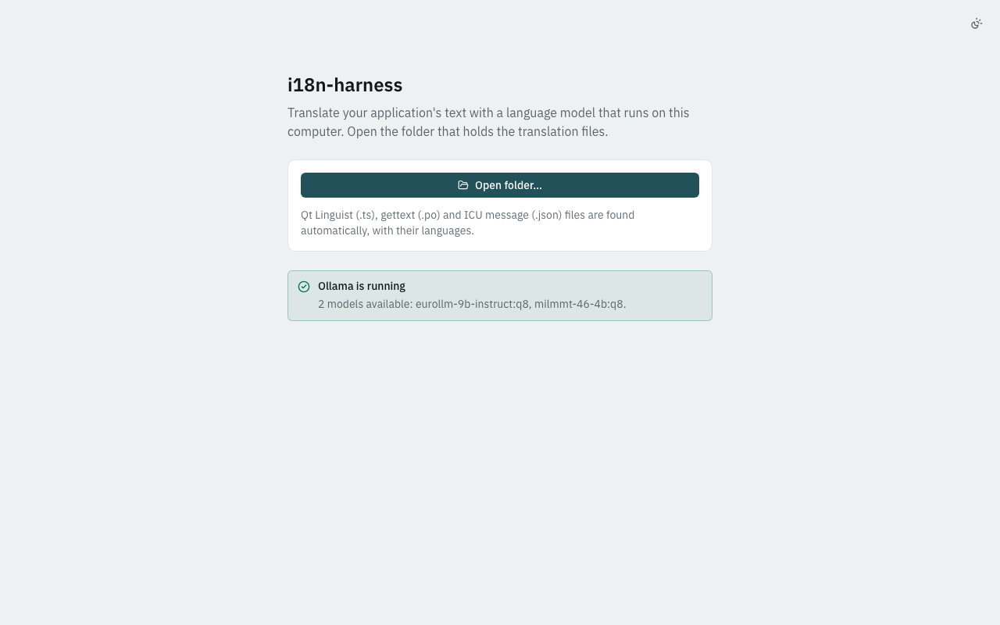

# Install Ollama and get a model

i18n-harness does not include a language model. It uses the models
installed on a model server. The simplest server is
[Ollama](https://ollama.com), which runs on your own computer.

## 1. Install Ollama

1. Download Ollama from [ollama.com/download](https://ollama.com/download)
   and install it like any other application.
2. Start it. On macOS and Windows it runs in the menu bar / system tray;
   on Linux it usually runs as a service.
3. Check that it answers. In a terminal:

   ```sh
   ollama list
   ```

   An empty table (or a list of models) means Ollama is running.

Ollama listens on `http://localhost:11434`. The app uses that address
unless you change it (see [Settings → Model server](first-translation.md#settings)).

## 2. Get a model

Any model that can generate text works. There are two kinds, and the app
handles both:

- **General instruction (chat) models** follow written instructions —
  "translate this, keep the placeholders". Most models in the Ollama
  library are of this kind.
- **Dedicated translation models** are trained to continue a fixed
  pattern such as `Translate this from German to Slovak:`. They are often
  smaller and faster for the same quality, but cannot follow extra
  instructions.

The app tells them apart from what Ollama reports about each model, not
from its name, and prompts each kind the way it expects. In the model
picker, dedicated translation models carry the note *translation model*.

### A model from the Ollama library

Pick a model on [ollama.com/search](https://ollama.com/search) and pull it
by name, for example:

```sh
ollama pull gemma3:12b
```

### A GGUF model from Hugging Face

Many translation models are published on Hugging Face in GGUF format.
Ollama can pull them directly:

```sh
ollama pull hf.co/<user>/<repository>:<quantization>
```

For example `hf.co/someone/SomeModel-GGUF:Q8_0`. The quantization
(`Q4_K_M`, `Q8_0`, …) is listed on the repository's *Files* page; larger
numbers mean better quality and more memory.

### Choosing a size

As a rough guide, a model needs about as much free memory (RAM, or
unified memory on Apple silicon) as the size of its download, plus some
room for the text. A 4–9 billion parameter model in `Q8_0` (5–10 GB) runs
well on a 16 GB machine. Which model translates *your* texts best is an
empirical question; [Choose a model with harness-lab](../tutorials/lab.md)
shows how to compare candidates on your own files.

## 3. Check what the app sees

Open the app. The start screen now says **Ollama is running** and lists
the models it found:



Embedding-only models (used for search, not for writing text) are left
out of the list on purpose.

## Other servers

LM Studio, vLLM, the llama.cpp server and cloud APIs work too; see
[Use an OpenAI-compatible server](../tutorials/openai-compatible.md).
