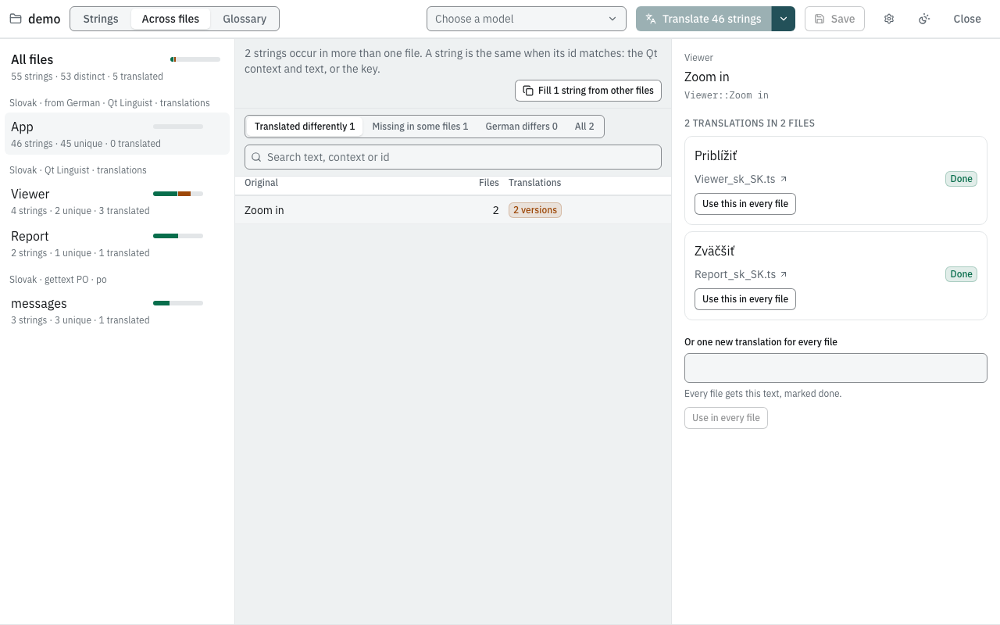
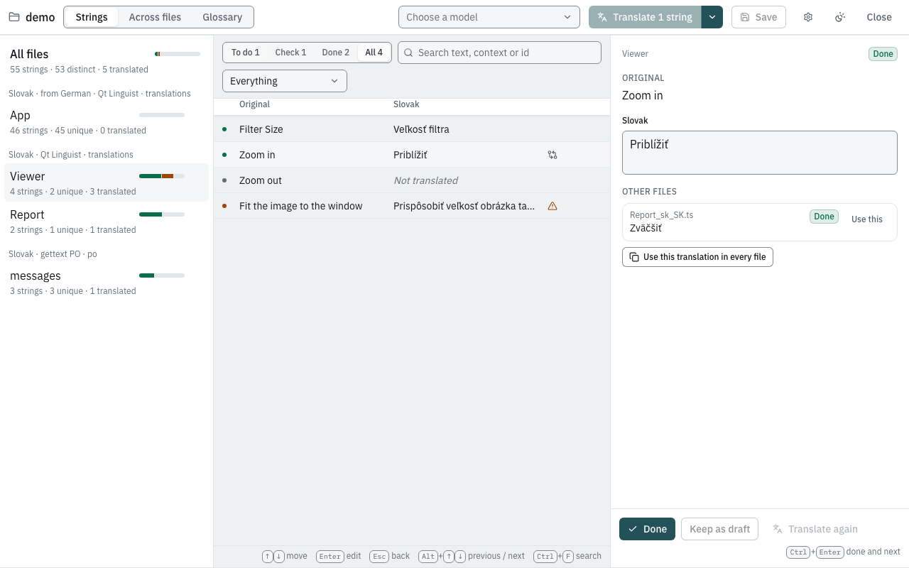

# Work across files

An application often has several translation files — one per module or
library — and the same string can occur in more than one of them: *Open*,
*Cancel*, a unit, a message shared by two dialogs. The app finds these
strings and keeps their translations in step.

Two strings are **the same** when their files have the same target
language and the strings have the same id and the same original text
(for Qt files the id is the context plus the original; for gettext,
`msgctxt` plus `msgid`). The original is compared too, because some
formats reuse a key for different text.

## See how much the files share

Each file in the file list counts its **unique** strings, the ones that
occur in no other file: the file's own work. The rest also appear
elsewhere. **All files** counts the **distinct** strings of the folder.

## Compare strings across files

**Across files** in the toolbar lists every string that occurs in more
than one file, with how many files have it and how they translate it:

- **Translated differently**: the files have more than one translation.
- **Missing in some files**: translated the same way where it is
  translated, still to do elsewhere.
- **German differs** (named after the language, for files that arrived
  filled with another language): the existing text differs between the
  files, a sign that the earlier translation was not consistent either.
- **All**.

Click a string to see each version of its translation with the files
that use it and their status. **Use this in every file** gives every file
that version, with its status. **Or one new translation for every file**
writes a new text to all of them, marked done. Click a file name to open
the string in that file. **Fill N strings from other files** at the top
does what the menu entry below does.

## Filter the strings of a file

The list next to the search has two entries for shared strings:

- **Also in other files** — every string that occurs in another file too.
- **Translated differently in other files** — strings whose translations
  are not the same in every file. An icon at the end of the row marks
  them.

**All files** at the top of the file list shows the strings of every file
in one list, with a **File** column. Search, the status tabs and the
filters work the same there, and **Translate N strings** translates
everything to do in every file.

## Fill strings from other files

When another file already translates a string that is still to do here,
the translation can simply be copied — no model needed.

1. Open the menu next to **Translate** (the arrow).
2. Choose **Fill from other files (N)**. *N* is how many strings to do,
   over every file, have a translation in other files that all agree.
3. Each of them gets that translation, with the status it has there:
   **Done** if it is done in one of the other files, otherwise **Check**.

Strings that other files translate *differently* are left to do, and the
message says how many; choose **Translated differently in other files**
to see them. Save to write the files.

## Resolve a string translated differently

Use **Across files** (above), or click the string in the strings view.
The editor shows an **Other files** section with each file's translation
and status:

- **Use this** next to another file's translation copies it into the
  editor; confirm it with **Done** or **Keep as draft** as usual.
- **Use this translation in every file** copies this file's saved
  translation, with its status, to the same string in every other file.
  Save your edit first; the button waits for it.

The changed files are marked unsaved; **Save** writes them.

## From the command line

`harness reuse` copies expert translations from *reference* files by
string id, for Qt files; see [Command line: harness](../reference/cli.md#reuse).
The cross-file features above work on the files of the open folder, in
every format.
