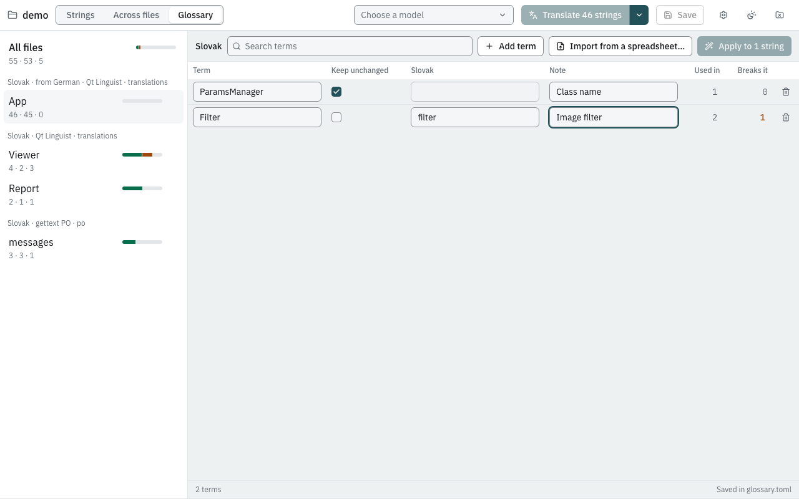

# Keep terms unchanged with a glossary

Product names, class names, units and abbreviations must usually stay as
they are; some words must always be translated the same way. The
glossary — a curated term list, often called a dictionary — tells the
model, and the checks hold the translations to it.

A glossary does not have to exist before you translate. You can import
one from a spreadsheet at any time and then
[apply it](#apply-a-glossary-to-finished-translations) to the strings
already translated.

## The example

A folder `glossary-demo` with `app_de.ts`:

```xml
<?xml version="1.0" encoding="utf-8"?>
<!DOCTYPE TS>
<TS version="2.1" language="de_DE">
<context>
    <name>Toolbar</name>
    <message>
        <source>Open ParamsManager</source>
        <translation type="unfinished"></translation>
    </message>
    <message>
        <source>Export to PhotoVault</source>
        <translation type="unfinished"></translation>
    </message>
    <message>
        <source>Delete the selected layer</source>
        <translation type="unfinished"></translation>
    </message>
</context>
</TS>
```

`ParamsManager` is a class name and `PhotoVault` a product name: both
must stay in English. *Layer* must always be *Ebene* in this product.

## Steps

1. Open `glossary-demo` in the app and click **Glossary** in the toolbar
   (next to **Strings**).
2. Click **Add term** and type `ParamsManager`. **Keep unchanged** is
   ticked for a new term. In **Note** write *Class name*.
3. Add `PhotoVault` the same way, with the note *Product name*.
4. Add `layer`, **untick** *Keep unchanged*, and type `Ebene` in the
   **German** column.

   

   *(The screenshot shows the demo project, which is Slovak.)*

   Every change is saved as you type; the line at the bottom says
   *Saved in glossary.toml*.
5. Click **Strings**, translate the file as usual and review under
   **Check**.

For each term the glossary shows **Used in** (how many strings contain
it) and **Breaks it** (how many translations do not follow it). Click a
number to see those strings, over every file: the strings view opens
with the **Glossary** or **Glossary breaks** chip on, narrowed to that
term.

In the strings view the same chips are above the list, and while one of
them is on, a list next to them picks the term. A book icon at the end of a row marks a
string with a glossary term, amber when its translation does not follow
it. The editor's **Glossary** section lists the terms of the selected
string with what the glossary requires (*keep unchanged* or the
translation) and whether the translation follows it; click a term to list
every string that uses it.

## Expected result

A run produced:

| Original | German |
|---|---|
| Open ParamsManager | ParamsManager öffnen |
| Export to PhotoVault | Export nach PhotoVault |
| Delete the selected layer | Die ausgewählte Ebene löschen |

If a model translates a *keep unchanged* term anyway — say it writes
*Parametermanager öffnen* — the string gets a red problem:
*"ParamsManager" must stay unchanged*. Like every red problem, it is not
written to the file until you fix it.

## How the glossary is used

| | Keep unchanged | Fixed translation |
|---|---|---|
| Told to a chat model | yes: *Keep these terms unchanged: ParamsManager.* | yes: *Use these translations: "layer" → "Ebene".* |
| Told to a dedicated translation model | no (these models take no instructions) | no |
| Checked after translation | **yes** — the term must occur in the translation exactly as often as in the original (whole word, same spelling and case); otherwise a red problem | **yes** — the fixed translation must occur, in any case and with an inflected ending; otherwise a yellow warning |

Matching details:

- A term is only mentioned to the model when it occurs in the string.
- *Keep unchanged* terms are matched case-sensitively as whole words:
  `ParamsManager` does not match inside `ParamsManagerDialog`.
- Fixed translations are found in the original as whole words, ignoring
  case. In the translation, each word of the fixed translation may end
  differently in its last two letters when it is longer than four letters,
  so *Ebenen* or *súboru* count as *Ebene* or *súbor*.
- **Note** is for people; it is not sent to the model.
- Fixed translations belong to one language. The column header shows
  which: the language of the file selected when you opened Settings. Open
  Settings from a file of another language to fill in that language.
  *Keep unchanged* applies to all languages.

## The term table

A glossary kept in a spreadsheet can be imported instead of typed. Save
the sheet as CSV (comma or semicolon) or tab-separated text, with one term
per row:

| term | translation | note |
|---|---|---|
| ParamsManager | | Class name |
| PhotoVault | | Product name |
| layer | Ebene | |

- A row **without a translation** (or with the term itself as the
  translation) is *keep unchanged*.
- A row **with a translation** is a fixed translation, in the language
  you import it for.
- *note* is optional. A first row starting with `term`, `source` or
  `original` is taken as a header and skipped. Cells may be quoted, as
  spreadsheets do for text containing the separator.

In the app: **Glossary** → **Import from a spreadsheet…** and pick the
file. A term already in the glossary is updated; nothing is removed. The
imported terms are saved at once, like any edit. From the command line:

```sh
harness import-glossary --language de_DE glossary-demo terms.csv
```

## Apply a glossary to finished translations

When the glossary arrives after the strings were translated — or you add
a term later — the existing translations do not follow it yet. The
checks find them: a changed *keep unchanged* term is a red problem, a
missing fixed translation a yellow warning.

1. Open **Glossary**. The button at the top reads
   **Apply to N strings**, counting every file of the folder, whatever
   the strings' status. (The same command is in the menu next to
   **Translate**, as *Apply the glossary*.)
2. Click it. Those strings are translated again with the glossary in the
   prompt and land under **Check** for review.
3. Strings that still break the glossary keep their warning or problem;
   the **Breaks it** numbers show where. Fix them in the editor.

The command-line equivalent is
`harness translate-folder <folder> --model <model> --fix-glossary --save`.

> **Dedicated translation models do not read the glossary.** A model
> without a chat template (such as MiLMMT) is given only the text, so
> retranslating with it cannot fix a glossary term. Apply the glossary
> with a chat model, fix the remaining strings by hand, or hand them to an
> agent ([Hand a batch to an AI coding agent](agent.md)).

## Where it is stored

The glossary is saved as `glossary.toml` next to `i18n-harness.toml`
(created on first save), and the settings file points to it:

```toml
[glossary]
path = "glossary.toml"
```

It is plain text meant to be kept in version control and edited by
hand if you like; see [The glossary file](../reference/glossary-file.md).
The command-line tools read the same file.
