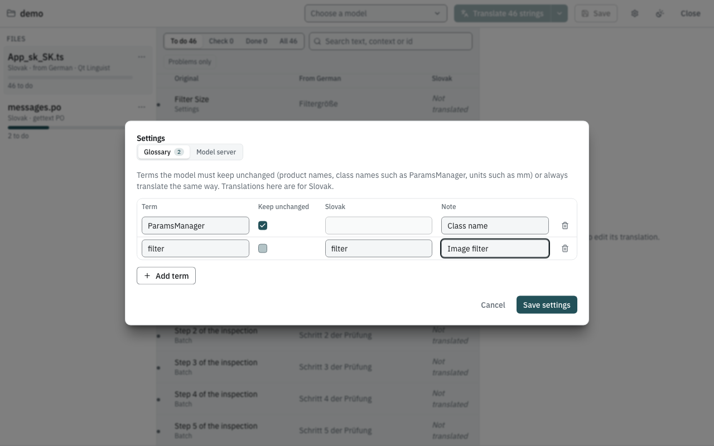

# Keep terms unchanged with a glossary

Product names, class names, units and abbreviations must usually stay as
they are; some words must always be translated the same way. The
glossary tells the model, and the checks hold it to the first rule.

## The example

A folder `glossary-demo` with `app_de.ts`:

```xml
<?xml version="1.0" encoding="utf-8"?>
<!DOCTYPE TS>
<TS version="2.1" language="de_DE">
<context>
    <name>Toolbar</name>
    <message>
        <source>Open ParamsManager</source>
        <translation type="unfinished"></translation>
    </message>
    <message>
        <source>Export to PhotoVault</source>
        <translation type="unfinished"></translation>
    </message>
    <message>
        <source>Delete the selected layer</source>
        <translation type="unfinished"></translation>
    </message>
</context>
</TS>
```

`ParamsManager` is a class name and `PhotoVault` a product name: both
must stay in English. *Layer* must always be *Ebene* in this product.

## Steps

1. Open `glossary-demo` in the app and click the **gear** button
   (**Settings**). The **Glossary** tab is open.
2. Click **Add term** and type `ParamsManager`. **Keep unchanged** is
   ticked for a new term. In **Note** write *Class name*.
3. Add `PhotoVault` the same way, with the note *Product name*.
4. Add `layer`, **untick** *Keep unchanged*, and type `Ebene` in the
   **German** column.

   

   *(The screenshot shows the demo project, which is Slovak.)*

5. Click **Save settings**.
6. Translate the file as usual and review under **Check**.

## Expected result

A run produced:

| Original | German |
|---|---|
| Open ParamsManager | ParamsManager öffnen |
| Export to PhotoVault | Export nach PhotoVault |
| Delete the selected layer | Die ausgewählte Ebene löschen |

If a model translates a *keep unchanged* term anyway — say it writes
*Parametermanager öffnen* — the string gets a red problem:
*"ParamsManager" must stay unchanged*. Like every red problem, it is not
written to the file until you fix it.

## How the glossary is used

| | Keep unchanged | Fixed translation |
|---|---|---|
| Told to a chat model | yes: *Keep these terms unchanged: ParamsManager.* | yes: *Use these translations: "layer" → "Ebene".* |
| Told to a dedicated translation model | no (these models take no instructions) | no |
| Checked after translation | **yes** — the term must occur in the translation exactly as often as in the original (whole word, same spelling and case); otherwise a red problem | no — review it yourself |

Matching details:

- A term is only mentioned to the model when it occurs in the string.
- *Keep unchanged* terms are matched case-sensitively as whole words:
  `ParamsManager` does not match inside `ParamsManagerDialog`.
- Fixed translations are matched as whole words, ignoring case.
- **Note** is for people; it is not sent to the model.
- Fixed translations belong to one language. The column header shows
  which: the language of the file selected when you opened Settings. Open
  Settings from a file of another language to fill in that language.
  *Keep unchanged* applies to all languages.

## Where it is stored

The glossary is saved as `glossary.toml` next to `i18n-harness.toml`
(created on first save), and the settings file points to it:

```toml
[glossary]
path = "glossary.toml"
```

It is plain text meant to be kept in version control and edited by
hand if you like; see [The glossary file](../reference/glossary-file.md).
The command-line tools read the same file.
