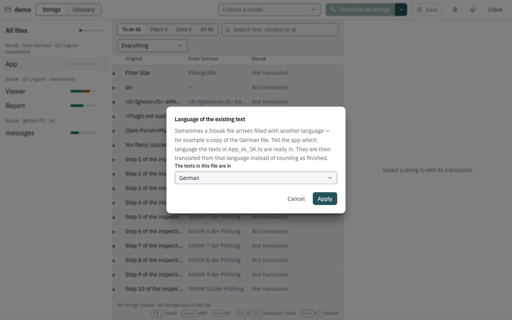
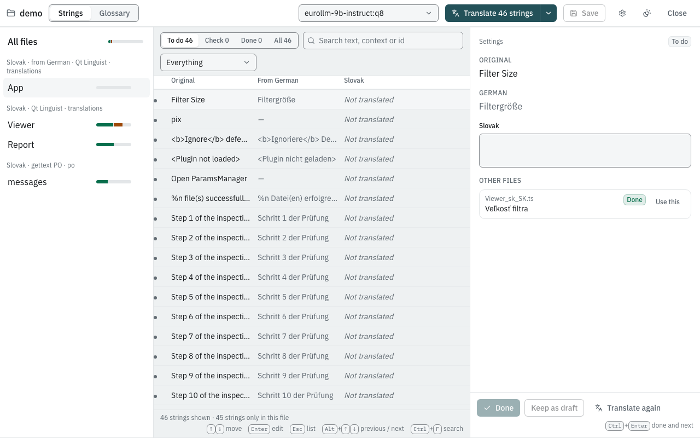

# Files pre-filled with another language

A common situation: a new language is started by copying an existing
translation. You receive `app_sk_SK.ts` — the Slovak file — but its
translations are still the **German** texts it was copied from. Some
strings were never translated at all.

Opened as is, the app would count the German texts as finished Slovak
translations. Telling it *"the texts in this file are German"* turns them
into input instead: every German text becomes **To do**, and the model
translates from the German (which is often closer to the intended
meaning and terminology than the English original), falling back to the
original where the German text is missing or broken.

## The example

Create a folder `pivot-demo` with `app_sk_SK.ts`:

```xml
<?xml version="1.0" encoding="utf-8"?>
<!DOCTYPE TS>
<TS version="2.1" language="sk_SK">
<context>
    <name>Settings</name>
    <message>
        <source>Filter Size</source>
        <translation>Filtergröße</translation>
    </message>
    <message>
        <source>pix</source>
        <translation></translation>
    </message>
    <message>
        <source>&lt;b&gt;Ignore&lt;/b&gt; defects under %1 mm</source>
        <translation>&lt;b&gt;Ignoriere&lt;/b&gt; Defekte unter %1 mm</translation>
    </message>
    <message>
        <source>&lt;Plugin not loaded&gt;</source>
        <translation>&lt;Plugin nicht geladen&gt;</translation>
    </message>
</context>
<context>
    <name>Import</name>
    <message>
        <source>Open ParamsManager</source>
        <translation type="unfinished"></translation>
    </message>
    <message numerus="yes">
        <source>%n file(s) successfully imported.</source>
        <translation>
            <numerusform>%n Datei(en) erfolgreich importiert.</numerusform>
            <numerusform></numerusform>
            <numerusform></numerusform>
        </translation>
    </message>
</context>
</TS>
```

## Steps

1. Open `pivot-demo` in the app. `app` is listed under *Slovak · Qt
   Linguist*, and only the two empty strings count as *to do* — the app
   believes the German texts are Slovak.
2. Hover `app` in the file list, click its **⋯** button and choose
   **Language of the existing text…**.

   

3. Choose **German** and click **Apply**.

   The file is now listed under *Slovak · from German · Qt Linguist*, all six
   strings are **To do**, and the table has a **From German** column
   with the existing texts. The Slovak column is empty: the German text
   is not a Slovak translation.

   

4. Pick a model and click **Translate 6 strings**.
5. Review under **Check** as usual. The editor shows the original, the
   German text, and the Slovak suggestion.
6. Click **Done** for each accepted string, then **Save**.

The choice is stored in `i18n-harness.toml` as `pivot = "de_DE"` in
the file's `[[catalogs]]` entry, so the folder opens the same way next
time. To undo it, open the same dialog and choose *Slovak (already
translated)*.

## Which text is translated

For each string the app decides what to send to the model:

| The German text is… | The model translates… |
|---|---|
| present for every form, with the same placeholders and markup as the original, and passes the checks | the **German** text (German → Slovak) |
| missing, incomplete (a plural with empty forms), or has lost a placeholder or a tag | the **original** (English → Slovak) |

A German text that already lost `%1` would pass the defect on, so it is
not used. In the example, `pix` and `Open ParamsManager` have no German
text, and the plural string has empty forms; those three are translated
from the original.

## Expected result

A run with a dedicated translation model produced this (abridged):

```xml
<source>Filter Size</source>
<translation>Veľkosť filtra</translation>
...
<source>&lt;b&gt;Ignore&lt;/b&gt; defects under %1 mm</source>
<translation>&lt;b&gt;Ignoruj&lt;/b&gt; chyby menšie ako %1 mm</translation>
...
<source>Open ParamsManager</source>
<translation type="unfinished">Otvoriť ParamsManager</translation>
...
<source>%n file(s) successfully imported.</source>
<translation>
    <numerusform>%n súbor(ov) bol(i) úspešne importovaný(é).</numerusform>
    <numerusform>Úspešne importovaných %n súborov.</numerusform>
    <numerusform>Úspešne importovaných %n súborov.</numerusform>
</translation>
```

Every placeholder and tag survived, so no check complained — but the
first plural form copies the English "(s)" style and the *few* form uses
the wrong case. Catching that is what the **Check** step is for.

Slovak has three plural forms in Qt files (*one*, *few*, *other*); each
is translated with its own example number (1, 2, 0).

> **Check before you release.** A string the file had already marked as
> finished keeps that mark when its text is replaced, so Qt's `lrelease`
> will include the new Slovak text even while the app still lists it
> under **Check**. Review the **Check** tab before you build a release
> from the file.

## From the command line

The same works unattended; `--pivot` sets the language of the existing
text for every file in the folder:

```sh
harness translate-folder pivot-demo --model <model> --pivot de_DE --save
```

See [Unattended runs with translate-folder](translate-folder.md).
`--input source` makes the model ignore the German text and always
translate from the original — useful to compare both inputs, which
[harness-lab](lab.md) does systematically.
